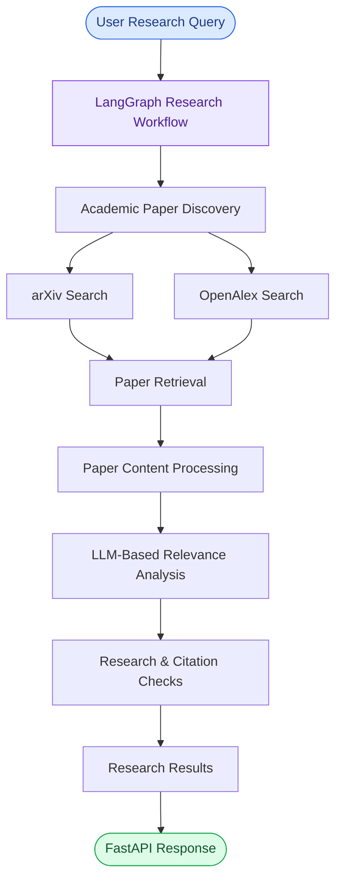

<div align="center">

# 📚 BeyondPaper

### AI-Powered Research Paper Assistant

**Go beyond searching. Discover, retrieve, and analyze research papers intelligently.**

An Agentic AI-powered research assistant that simplifies academic research through intelligent paper discovery, retrieval, relevance evaluation, and analysis.

<br/>

[](https://www.python.org/)
[](https://www.langchain.com/langgraph)
[](https://fastapi.tiangolo.com/)
[](https://www.trychroma.com/)
[](https://groq.com/)

<br/>

<a href="https://beyond-paper-inky.vercel.app/">
  <strong>🌐 Live Demo</strong>
</a>
&nbsp; | &nbsp;
<a href="https://github.com/smilingstar78/BeyondPaper">
  <strong>💻 GitHub Repository</strong>
</a>

</div>

---

## 📖 Overview

BeyondPaper is an **Agentic AI-powered research assistant** designed to simplify the process of discovering, retrieving, and analyzing academic research papers from multiple sources.

Built using **LangGraph, Large Language Models (LLMs), and FastAPI**, BeyondPaper implements an intelligent, condition-driven workflow that coordinates research tasks, evaluates paper relevance, and supports deeper analysis of academic literature.

Instead of manually navigating through countless research papers, users can leverage an AI-driven workflow to make academic literature discovery and analysis more efficient.

## ✨ Key Features

<table>
<tr>
<td width="50%">

### 🔍 Multi-Source Discovery
Retrieves academic research papers from multiple sources, including arXiv and OpenAlex.

</td>
<td width="50%">

### 🤖 Agentic Workflow
Uses LangGraph to coordinate research tasks through interconnected nodes and conditional routing.

</td>
</tr>
<tr>
<td width="50%">

### 🎯 Relevance Evaluation
Uses LLM-powered analysis to assess how closely retrieved papers align with the research topic.

</td>
<td width="50%">

### 📄 Paper Analysis
Processes research paper content to support a deeper understanding of academic literature.

</td>
</tr>
<tr>
<td width="50%">

### ✅ Research Verification
Incorporates citation and research-quality verification checks to support more reliable research evaluation.

</td>
<td width="50%">

### 🧠 Vector Storage
Uses ChromaDB for persistent vector storage and semantic retrieval.

</td>
</tr>
<tr>
<td width="50%">

### ⚡ API Integration
Provides a FastAPI backend for handling research requests and workflow execution.

</td>
<td width="50%">

### 🌊 Streaming Support
Includes Server-Sent Events (SSE)-related capabilities for asynchronous response delivery.

</td>
</tr>
</table>

---

## 🧠 How It Works

BeyondPaper follows an agentic research workflow orchestrated using **LangGraph**.

1. **User Input:** The user submits a research topic or query.
2. **Paper Discovery:** The system searches academic sources such as arXiv and OpenAlex.
3. **Paper Retrieval:** Relevant research papers and their available information are collected.
4. **Content Processing:** Retrieved paper content is processed for further analysis.
5. **Relevance Evaluation:** An LLM-powered component evaluates the relevance of retrieved papers to the research topic.
6. **Verification:** Research and citation-related checks help assess the quality and reliability of retrieved information.
7. **Results:** Research findings are returned through the backend API.

### 🔄 Workflow Architecture

<div align="center">



</div>

---

## 🛠️ Tech Stack

<div align="center">

| Category | Technologies |
|:---:|:---|
| **Programming Language** | Python |
| **Agentic Framework** | LangGraph |
| **LLM Integration** | LangChain, Groq |
| **Language Model** | GPT-OSS-120B (via Groq) |
| **Academic APIs** | arXiv, OpenAlex |
| **Tool Integration** | MCP |
| **Vector Database** | ChromaDB |
| **Backend Framework** | FastAPI |
| **Communication** | REST API, SSE-related support |
| **PDF Processing** | PyPDF |
| **Deployment** | Vercel |

</div>

---

## 🏗️ Project Structure

```text
BeyondPaper/
│
├── frontend/
│   └── src/
│       └── api.js
│
├── main.py              # LangGraph research workflow
├── server.py            # FastAPI backend and API endpoints
├── paper_reader.py      # PDF reading and text extraction
├── tools.py              # Research and retrieval tools
│
├── requirements.txt     # Project dependencies
├── vercel.json          # Deployment configuration
└── README.md
```

---

## 🚀 Getting Started

Follow these steps to run BeyondPaper locally.

### 1. Clone the Repository

```bash
git clone https://github.com/smilingstar78/BeyondPaper.git
```

### 2. Navigate to the Project Directory

```bash
cd BeyondPaper
```

### 3. Create a Virtual Environment

```bash
python -m venv venv
```

Activate the environment:

**Windows:**
```bash
venv\Scripts\activate
```

**Linux / macOS:**
```bash
source venv/bin/activate
```

### 4. Install Dependencies

```bash
pip install -r requirements.txt
```

### 5. Configure Environment Variables

Create a `.env` file in the project root directory and add your Groq API key.

```env
GROQ_API_KEY=your_groq_api_key
```

> ⚠️ Never commit your API keys or other sensitive credentials to GitHub.

### 6. Run the Backend

```bash
uvicorn server:app --reload
```

The FastAPI application will be available at:

```text
http://127.0.0.1:8000
```

Access the interactive API documentation:

```text
http://127.0.0.1:8000/docs
```

---

## 🔌 API Overview

The FastAPI backend provides endpoints for interacting with the research workflow.

| Endpoint | Method | Description |
|:---|:---:|:---|
| `/` | GET | Backend health/status response |
| `/research` | POST | Initiates the research workflow |

The `/research` endpoint invokes the LangGraph research workflow and processes the submitted research request.

---

## 💡 Why BeyondPaper?

Academic research often involves searching across multiple platforms, reviewing large volumes of literature, and manually identifying relevant studies.

BeyondPaper explores how **Agentic AI can simplify this process** by bringing together:

- Autonomous workflow orchestration.
- Multi-source academic information retrieval.
- LLM-powered relevance analysis.
- Research paper processing.
- Citation and research-quality checks.
- Structured research workflows.

The goal is to make academic literature discovery and analysis more efficient, accessible, and intelligent.

---

## 🔮 Future Enhancements

- [ ] Advanced multi-agent collaboration for specialized research tasks.
- [ ] Improved citation validation and reference tracing.
- [ ] Research paper comparison and summarization.
- [ ] Research gap identification.
- [ ] Automated literature review generation.
- [ ] Enhanced streaming responses and interactive research sessions.
- [ ] Integration with additional academic databases.

---

## 👩‍💻 Developer

<div align="center">

### Muskan Tariq

**AI Engineer | Generative AI | Agentic AI**

<a href="https://github.com/smilingstar78">
  
</a>

<a href="https://www.linkedin.com/in/muskan-tariq-095a50282/">
  
</a>

</div>

---

<div align="center">

### ⭐ If you find BeyondPaper interesting, consider giving this repository a star!

**Built with curiosity, intelligent workflows, and a passion for Agentic AI.**

*Beyond searching. Beyond reading. BeyondPaper.*

</div>
